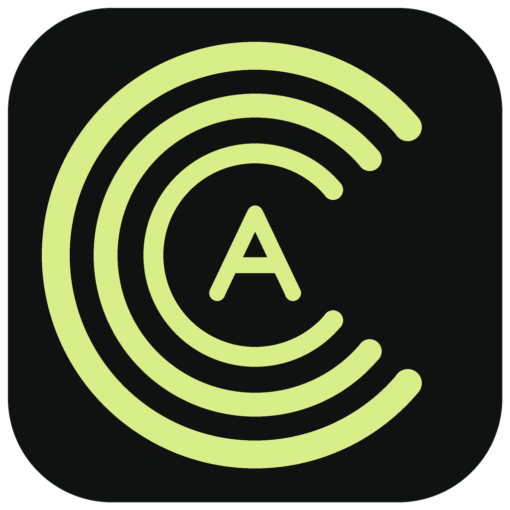
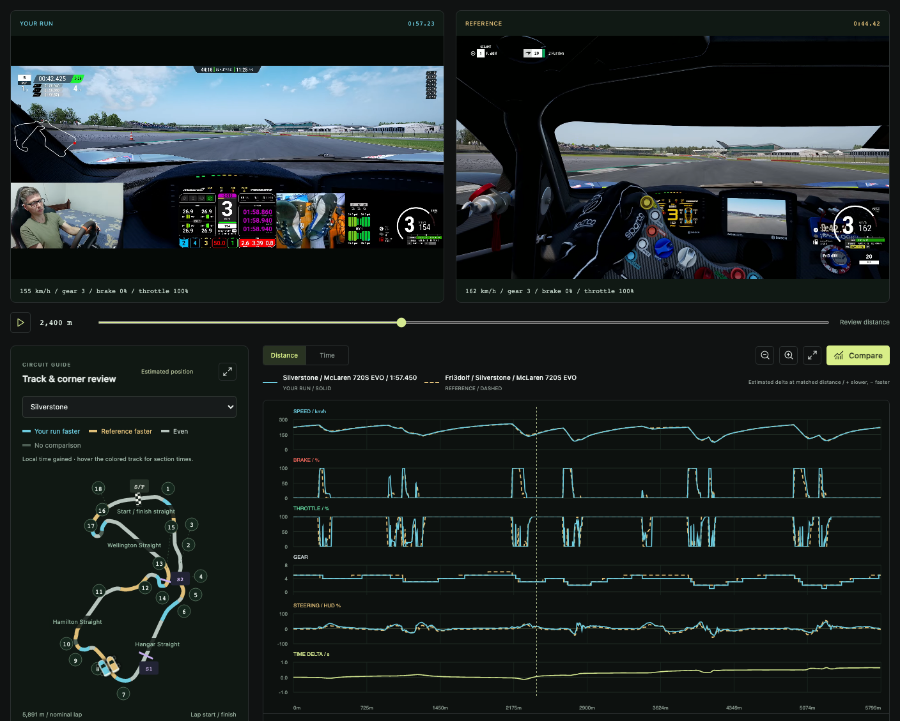
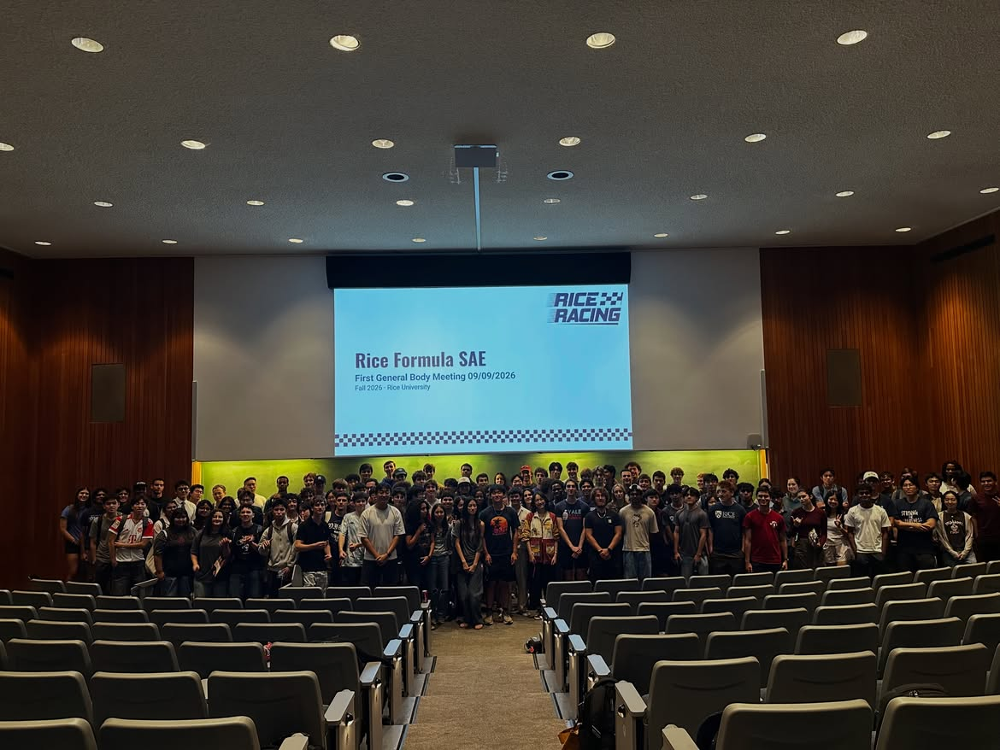

  

# ACCC Telemetry — Free Assetto Corsa Competizione Video Analysis

**ACC Console Telemetry — understand your inputs, learn from a great lap.**

**ACCC Telemetry is completely free for everyone to use.** Every feature is
available without a purchase, subscription, or donation.

Made by **Rice Racing**, Rice University's Formula SAE team. ACCC Telemetry turns
recorded Assetto Corsa Competizione gameplay into brake, throttle, speed, gear,
and steering traces you can study alongside a reference lap. Console drivers
deserve useful analysis tools too.

Record your ACC laps on **PlayStation, Xbox, or PC**, then analyze the gameplay
video on **Windows, macOS, or Linux**. Compare braking points and throttle
application, review synchronized videos, and see where time is gained or lost.

This is a **recorded-lap analysis app**. Import a video, review your driving, and
compare it with a strong lap. It does not monitor live racing or provide live
telemetry. Your recordings and analysis stay on your computer.

[Website](https://saberdinp.github.io/ACCCT/) · [Download](#download-the-app) · [How to use](#your-first-comparison)
· [FAQ](#frequently-asked-questions) · [Report a problem](https://github.com/SaberDinp/ACCCT/issues)

## Download the app

**Download an installer below. You do not need Python, Node.js, or the source-code ZIP.**

| Your computer | Download v1.4.1 | How to install |
| --- | --- | --- |
| **Mac with Apple Silicon** — M-series; macOS 14+ | [Download for Apple Silicon](https://github.com/SaberDinp/ACCCT/releases/download/v1.4.1/ACCC-Telemetry-1.4.1-mac-arm64.dmg) | Open the DMG, drag the app into **Applications**, then open it. |
| **Mac with an Intel processor** — macOS 13+ | [Download for Intel Mac](https://github.com/SaberDinp/ACCCT/releases/download/v1.4.1/ACCC-Telemetry-1.4.1-mac-x64.dmg) | Open the DMG, drag the app into **Applications**, then open it. |
| **Windows 10/11** — 64-bit Intel/AMD | [Download for Windows](https://github.com/SaberDinp/ACCCT/releases/download/v1.4.1/ACCC-Telemetry-1.4.1-win-x64.exe) | Run the installer, then open **ACCC Telemetry** from Start or the Desktop shortcut. |
| **Ubuntu / Debian / Linux Mint** — Intel/AMD 64-bit | [Download DEB](https://github.com/SaberDinp/ACCCT/releases/download/v1.4.1/ACCC-Telemetry-1.4.1-linux-amd64.deb) | Open it in your software installer and choose **Install**. |
| **Fedora / openSUSE** — Intel/AMD 64-bit | [Download RPM](https://github.com/SaberDinp/ACCCT/releases/download/v1.4.1/ACCC-Telemetry-1.4.1-linux-x86_64.rpm) | Open it in your software installer and choose **Install**. |
| **Other compatible Linux desktops** — Intel/AMD 64-bit | [Download AppImage](https://github.com/SaberDinp/ACCCT/releases/download/v1.4.1/ACCC-Telemetry-1.4.1-linux-x86_64.AppImage) | In file Properties, allow executing it as a program, then open it. |
| **Linux ARM64 / AArch64** | [DEB](https://github.com/SaberDinp/ACCCT/releases/download/v1.4.1/ACCC-Telemetry-1.4.1-linux-arm64.deb) · [RPM](https://github.com/SaberDinp/ACCCT/releases/download/v1.4.1/ACCC-Telemetry-1.4.1-linux-aarch64.rpm) · [AppImage](https://github.com/SaberDinp/ACCCT/releases/download/v1.4.1/ACCC-Telemetry-1.4.1-linux-arm64.AppImage) | Choose the package for your distribution, as above. |

Not sure which Mac you have? **Apple menu → About This Mac** shows an Apple chip
or an Intel processor. On Linux, `uname -m` shows `x86_64` or `aarch64`.

[All downloads, portable ZIP/TAR archives, and release notes](https://github.com/SaberDinp/ACCCT/releases/latest)
· [Checksums](https://github.com/SaberDinp/ACCCT/releases/latest/download/SHA256SUMS.txt)
· [Detailed installation help](desktop/README.md)

Mac builds are not Apple-notarized; Windows builds are unsigned. A first launch
may be blocked. On macOS, after attempting to open the
app, use **System Settings → Privacy & Security → Open Anyway** if shown. On
Windows, an unknown-publisher prompt may offer **More info → Run anyway**.
Use these options only for a download you trust from this repository.

Linux needs a graphical desktop with GTK 3 and glibc 2.28+. DEB/RPM packages are
the easiest option because the package manager installs the system libraries.
32-bit systems, PowerPC Macs, macOS below the versions above, native Windows ARM,
and Alpine/musl Linux are not supported. See each release's notes for test coverage.

## Your first comparison

*Compare your lap with a reference using synchronized video, input traces, and
the circuit map.*

1. **Import your recording.** Open **Video options** for **Your run**, choose
   **Import recording**, and browse to a gameplay video with the ACC input HUD visible.
2. **Find a reference.** Under **Reference → Video options**, choose **Find reference lap**,
   select your circuit and car, and import a creator's lap. The first import downloads
   and analyzes that video; later selections reuse your saved analysis. You can also
   import your own local reference or paste a supported public recording link.
3. **Choose the laps.** In **Analysis**, use each video's
   **Start of lap** and **End of lap**. Choose the frame and press **Lock**.
   Use recordings from the same circuit layout.
4. **Look for the difference.** Play both laps, inspect braking and throttle
   application, and compare speed, gear, steering, and estimated time delta.
   You can review a single recording before adding a reference.

Use **Open video in browser** on either recording to watch the full video with sound.
Online recordings open their original page; local files open a player in your browser.
Keep the app open while watching local files.

The reference picker lists all 54 ACC car variants and all 25 circuits. Its
**6,084 video links cover 1,082 car-and-circuit combinations**, with multiple
options for 975 combinations. Some combinations still need references; the
picker says when none are available. Only links and metadata files ship
with the app. [See the library's coverage and sources](assets/references/README.md).

Choose saved recordings from **Video options** in the comparison area. HUD
detection runs automatically. The track guide can suggest a circuit from lap
telemetry; you can always choose the circuit yourself. **Credits** introduces
the team and links to our official donation page. No account or subscription
is required.

The app reads visible video pixels, so clear footage matters. Hidden inputs,
compression, missing frames, and different conditions can limit a comparison.
This is video-derived telemetry: map position and distance are estimates, not
GPS or a measured racing line. [Read the analysis guide](docs/ANALYSIS.md).

## Frequently asked questions

### Does the app run on a PlayStation or Xbox?

The app runs on a Windows, Mac, or Linux computer. Transfer your recorded console
gameplay to that computer, then import it with the ACC input HUD visible.

### Do I need an account or an Internet connection?

No account is required. You can analyze local video files without Internet access.
Importing a public reference video needs an Internet connection; the recording
and its analysis are then saved locally for reuse.

YouTube imports use an anonymous downloader. A public video can still be refused
by YouTube; signing into your browser does not sign the app in. See
[YouTube download troubleshooting](docs/ANALYSIS.md#youtube-downloads-and-sign-in)
for HTTP 403 errors, other failure messages, and diagnostic logs.

### Is this the same as live ACC telemetry or a MoTeC data logger?

No. ACCC Telemetry reads visible HUD pixels from recorded videos. It cannot
recover hidden inputs, suspension data, or an exact racing line. CSV exports are
available; proprietary MoTeC `.ld` files are not. See the
[analysis guide](docs/ANALYSIS.md#what-can-be-measured) for supported measurements.

## Report a problem or suggest a feature

You can report a bug or suggest a future feature in the
**[Issues tab](https://github.com/SaberDinp/ACCCT/issues)**. Include your operating
system, app version, and the steps that caused the problem so we can investigate.
We'll work on fixing reported problems as soon as possible.

You never need to donate to report an issue or receive fixes. Share only
recordings you have permission to share; a short HUD example is often more
useful than a full race.

## Meet Rice Racing

We are a group of Rice University students designing and building a formula race
car to compete in **Formula SAE**. We learn by turning ideas into hardware,
testing them, and making the next iteration better. We built ACCC Telemetry with
that same spirit: give console racers a clearer way to understand their driving
and learn from the inputs of excellent drivers.

*Rice Racing at its first general body meeting of the 2026–27 season. Photo: Rice Racing.*

[Meet the team at riceracing.org](https://www.riceracing.org/)

## Free to use — help us keep building

**The app is completely free, and donating is entirely optional.** If you enjoy
ACCC Telemetry and want to see more features in the future, a donation is a way
to support Rice Racing and encourage us to keep improving the app.

Gifts go to **Rice Formula SAE Club** and support our student team's work
designing, building, and competing with a formula race car.

### How to give

1. Go to **[giving.rice.edu](https://giving.rice.edu/)** and click **Make a Gift**.
2. Under **“Please select an area of Rice to support”**, choose **Other** and enter
   our official name exactly:

   **Rice Formula SAE Club**

**[Support Rice Racing through Rice University →](https://giving.rice.edu/)**

Thank you for helping us keep building and learning. Donations are optional;
every app feature is available without donating. The gift is completed through
Rice University's giving site, and the app does not collect payment details.

## For contributors

The repository contains source code, tests, icons, team photos, and the small
assets needed by the analyzer. Installers are attached to **GitHub Releases**.
Private recordings, session databases, downloaded videos, virtual environments,
build tools, and generated reports are excluded from Git.

- [Run from source and contribute](docs/DEVELOPMENT.md)
- [Build desktop installers](desktop/README.md#build-from-source)
- [Analysis and comparison details](docs/ANALYSIS.md)
- [Report a problem or suggest an improvement](https://github.com/SaberDinp/ACCCT/issues)

Bundled track-data licenses and provenance are documented in
[assets/tracks/README.md](assets/tracks/README.md).

Independent application; not affiliated with Kunos, PlayStation, Xbox, Twitch,
YouTube, or MoTeC.
